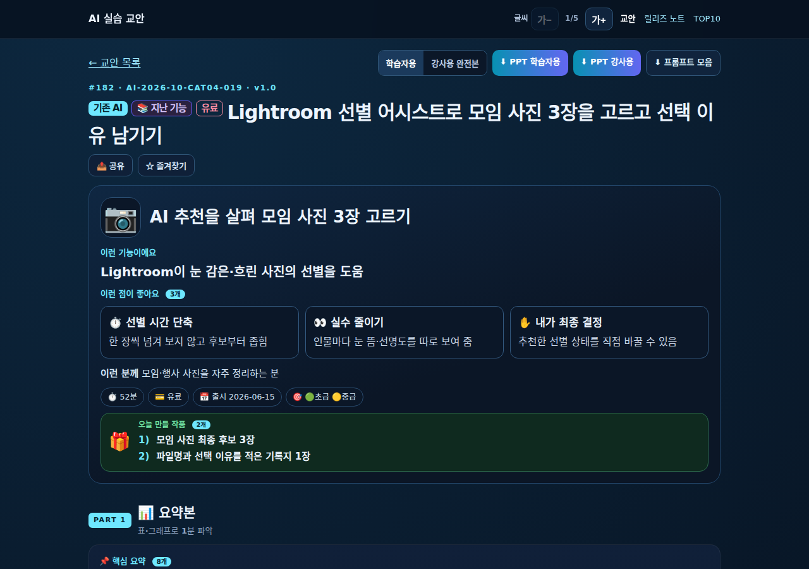
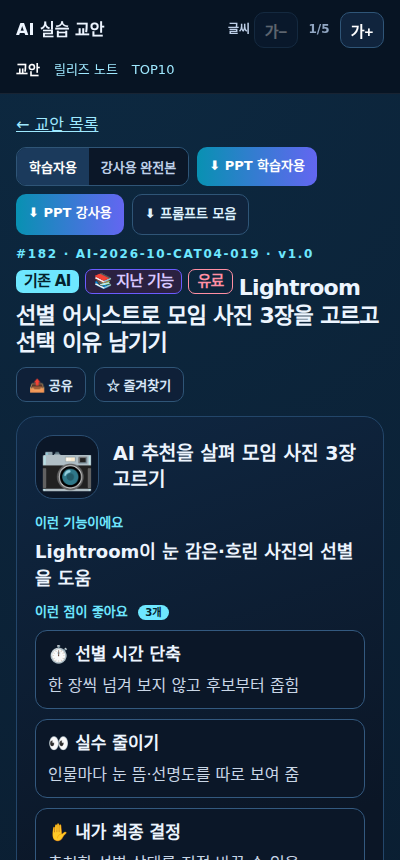

# 교안 첫 화면 기능·혜택 개선 보고서 (v2.4)

대상 저장소: `johnpark236-tech/ai-instructor-update-log`  
작업 브랜치: `feat/glance-benefits-v24` · [PR #8](https://github.com/johnpark236-tech/ai-instructor-update-log/pull/8)  
상태: PR에서 검토 중이며 main·실제 서비스에는 아직 반영하지 않음

## 바뀐 파일

| 파일 | 변경 요지 |
|---|---|
| `lessons.html` | 첫 영역에 쉬운 기능 설명·혜택 3개·맞는 대상 배치. PART 1의 기존 cards는 실습 흐름으로 구분. 강사 수준은 핵심 요약표에 유지 |
| `lesson-pptx.js` | 학습자·강사용 한눈에 보기에 새 필드 표시. 혜택 표는 benefits, 실습 흐름은 cards 사용. 구형 데이터는 기존 방식 유지 |
| `scripts/build_lessons_index.py` | 새 필드 길이·개수·이모지·복사 방지 검사. 기존 문체 검사가 새 필드도 검사. 목록에 what 추가 |
| `scripts/backfill_glance_v24.py` | 내부 교안 근거로 작성한 표시 문구와 재현 가능한 백필. 새 ID는 추측하지 않고 보류 |
| `lessons/*.json` 183개 | glance.what·benefits·for_whom만 추가. 그 외 필드와 version·cards 보존 |
| `lessons.json` | 스크립트로 생성. 기존 키·형식 보존, what 추가, standard v2.4 |
| `docs/lesson-standard-v2.md` | v2.4 기준·필드·작성 규칙·백필 기록 |
| `docs/codex-handoff.md` | glance의 새 필드 길이·개수 추가 |
| `automation/codex/prompts/lesson.md`, `review.md` | 신규 교안의 필수 필드·혜택 판별·검토 조건 추가 |
| `automation/codex/generation-schema.json` | 상태 응답은 유지하고 교안 표시 필드 정의 추가. 실제 파일 필수 검사는 인덱스 검사기가 수행 |
| `tests/test_glance_v24.py` | 필수·길이·개수·이모지·복사·문체 및 전체 인덱스 검사 |
| `tests/glance_v24.browser.cjs` | 실제 Chromium의 첫 화면·모바일·최대 글씨·구형 데이터 검증 및 캡처 |
| `.github/workflows/glance-v24-review.yml` | 작업 브랜치에서 읽기 전용 검증·PPT 생성·화면 증거 보관. 기존 매시간 발행 예약은 변경하지 않음 |
| `docs/reports/glance-v24/*` | 보고서·브라우저 측정 결과·스크린숏 |

## 백필 범위와 근거

- 백필: **183개 / 실제 교안 파일 183개**
- 근거 부족 보류 ID: **없음**
- 외부 자료를 새로 추가하지 않고 같은 교안의 feature·summary·theory·pricing·outcome·sources로만 작성
- 근거 없는 시간 절감 수치·배수·완벽 보장·실습 결과물 개수를 혜택에 넣지 않음
- Lightroom의 “AI가 사진을 삭제하지 않음”은 내부 can/cannot에서 확정되지 않아 쓰지 않고, 확인된 “추천한 선별 상태를 직접 바꿀 수 있음”으로 표시
- style_terse.py --fix 실행 후 모든 기존 필드를 원본과 대조·보존하고 새 세 필드만 남김. 검증은 --check 및 인덱스 생성으로 재확인
- 무작위 검토: 고정 seed 24. 아래 5개 교안에 대해 theory.can·기능 설명과 대조

| 교안 | 확인한 혜택 | 검토 결과 |
|---|---|---|
| CAT05-026 Firefly 음악 | 음악 찾기 수고 감소·모임 분위기 반영·곡 선택 | 태그·설정으로 모임용 음악 생성이라는 내부 근거와 일치 |
| CAT08-016 Grok 앱 연결 | 앱 이동 수고 감소·대화에서 앱 결과 보기·권한 선택 | “대화 안에서 앱 결과를 확인함”을 “앱 결과를 대화에서 바로 볼 수 있음”으로 고쳐 할 일 대신 얻는 점 명확화 |
| CAT03-028 Genspark AI Docs | 문서 꾸미기 부담 감소·배치된 초안·부분 수정 | 디자인된 문서와 선택 수정이라는 내부 근거와 일치 |
| CAT04-002 ChatGPT 스티커 | 낱장 제작 수고 감소·수업 맞춤 스티커·결과 선택 | “그림을 나눠 씀”을 “내 수업에 맞는 스티커를 나눠 쓸 수 있음”으로 구체화 |
| CAT03-024 ChatGPT Library | 재업로드 감소·공유 자료 활용·공유 범위 선택 | 라이브러리 재사용·공유 기능이라는 내부 근거와 일치 |

## 완료 기준

1. **통과:** 인덱스 검사. count 183 = 파일 수 183. 기존 교안 필드는 모두 불변이며 인덱스의 기존 키도 보존
2. **통과:** automation/codex/tests 26개, v2.4 필드 검사 4개, 기존 퀴즈·실습 입력처 검사 통과
3. **통과:** Chromium 1280×900에서 “이런 기능이에요”와 혜택 3개가 첫 화면 안에 표시. 혜택 카드 바닥 약 566px
4. **통과:** 400×860 1열, 최대 글씨 크기 가로 넘침 없음. 확대 시 본문이 과도하게 좁아지는 기존 계산도 viewport 기준으로 보완
5. **통과:** 임시 응답에서 새 필드 3개를 제거해도 기존 화면 표시, 브라우저 오류 없음
6. **통과:** scripts/build_downloads.js가 PPT 366개 생성. 학습자·강사용 파일의 슬라이드 2에 기능 설명·혜택·대상, 슬라이드 3에 실습 흐름이 포함됨. 위 무작위 5개 검토 수행

브라우저 좌표·오류·최대 글씨 결과는 [browser-results.json](browser-results.json)에 기록. [검증 실행 기록](https://github.com/johnpark236-tech/ai-instructor-update-log/actions/workflows/glance-v24-review.yml)에서 실제 CI 결과와 PPT 파일 확인 가능

## 1280×900

## 400×860

최대 글씨 크기 증거: [mobile-400-max.png](mobile-400-max.png)

## 최종 main 동기화

자동 발행이 추가한 `AI-2026-10-CAT04-020`(Lightroom 먼지 제거)을 읽고 백필에 포함. 원래 데이터의 자동 감지·지점별 보완·잘못 지운 보정 취소만 근거로 표시 문구 추가. 최신 main `a480602fb7e08dfd7310b34f6afffa6a6af35073`에 로컬 작업 브랜치를 리베이스하고 인덱스를 다시 생성함. 최종 183개와 릴리즈 노트 259건 보존
